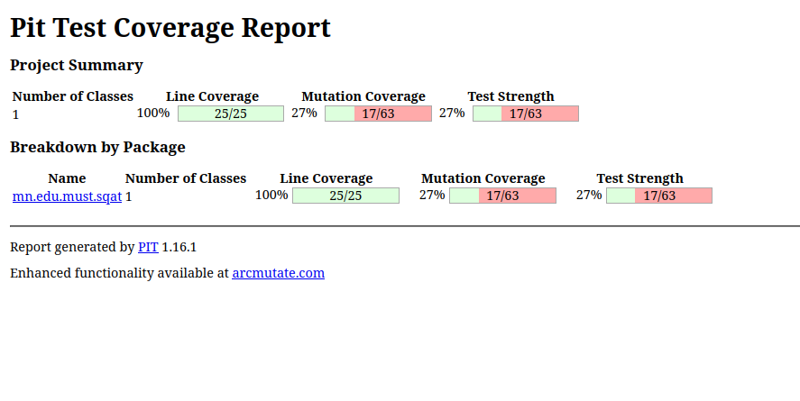
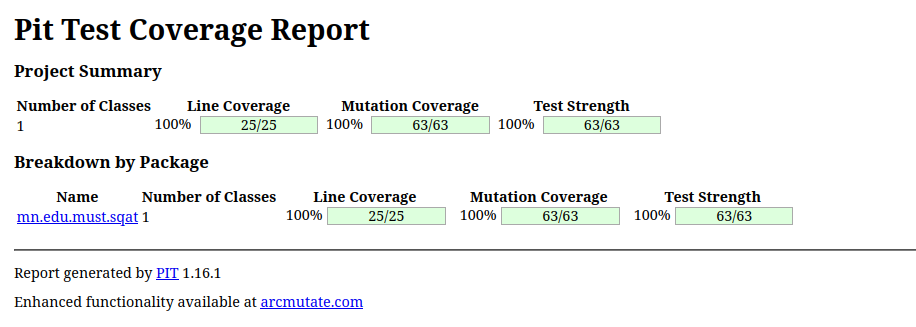

# Лаб 11 - B232270068 А.Баяржавхлан

## Туршилтын орчин

Java:
```
openjdk version "21.0.13.1" 2026-11-17
OpenJDK Runtime Environment (build 21.0.13.1+2-1-24.04.1-Ubuntu)
OpenJDK 64-Bit Server VM (build 21.0.13.1+2-1-24.04.1-Ubuntu, mixed mode, sharing)
```

Maven:
```
Apache Maven 3.8.7
Maven home: /usr/share/maven
Java version: 21.0.13.1, vendor: Ubuntu, runtime: /usr/lib/jvm/java-21-openjdk-amd64
Default locale: en_US, platform encoding: UTF-8
OS name: "linux", version: "6.8.0-151-generic", arch: "amd64", family: "unix"
```

OpenJDK 21 + Maven 3.8.7 орчинд ажиллуулахын тулд starter-ийн `pom.xml`-ийг зассан: `maven.compiler.release` 17 → 21, `maven-compiler-plugin` 3.13.0, `maven-resources-plugin` 3.3.1

`results/` доторх бүх гаралтыг ANSI escape sequence-гүй байлгахын тулд `ansi2txt`-ээр дамжуулж хадгалсан:
```bash
mvn clean verify 2>&1 | ansi2txt | tee results/mvn-verify-start.txt
cp target/site/jacoco/jacoco.csv results/jacoco-start.csv
mvn clean test-compile org.pitest:pitest-maven:mutationCoverage 2>&1 | ansi2txt | tee results/pit-start.txt
```


## Эхний хэмжилт

### JaCoCo

`results/mvn-verify-start.txt`: `Tests run: 6, Failures: 0, Errors: 0, Skipped: 0`. `results/jacoco-start.csv`:

| Хэмжүүр     | Covered | Missed | Нийт | Хамралт |
| ----------- | ------- | ------ | ---- | ------- |
| Line        | 25      | 0      | 25   | 100%    |
| Branch      | 38      | 3      | 41   | ≈ 92.7% |
| Instruction | 152     | 0      | 152  | 100%    |


Дутуу 3 салаа: 48-р мөрийн `gpa < 0`-ийн үнэн утга (сөрөг голчтой тест байхгүй), 52, 53-р мөрийн `&&`-ийн голч хангасан ч кредит дутуу тохиолдол.

### PIT

`results/pit-start.txt`:
```
>> Line Coverage (for mutated classes only): 25/25 (100%)
>> Generated 63 mutations Killed 17 (27%)
>> Mutations with no coverage 0. Test strength 27%
```

| Мутатор (PIT)                         | Generated | Killed | Survived |
| ------------------------------------- | --------- | ------ | -------- |
| `ConditionalsBoundaryMutator`         | 14        | 1      | 13       |
| `RemoveConditionalMutator_ORDER_IF`   | 14        | 4      | 10       |
| `RemoveConditionalMutator_ORDER_ELSE` | 14        | 5      | 9        |
| `RemoveConditionalMutator_EQUAL_IF`   | 3         | 2      | 1        |
| `RemoveConditionalMutator_EQUAL_ELSE` | 3         | 2      | 1        |
| `MathMutator`                         | 5         | 3      | 2        |
| `EmptyObjectReturnValsMutator`        | 5         | 0      | 5        |
| `PrimitiveReturnsMutator`             | 4         | 0      | 4        |
| `experimental.SwitchMutator`          | 1         | 0      | 1        |
| **Нийт**                              | **63**    | **17** | **46**   |




## Хэсэг A: Амьд мутантуудын ангилал

`results/pit-start.txt` дахь 46 амьд мутантыг PIT-ийн HTML тайлангаас (`target/pit-reports/mn.edu.must.sqat/ScholarshipCalculator.java.html`) нэг бүрчлэн үзэж ангилсан. Ижил шалтгаантай мутантуудыг нэг мөрөнд нэгтгэв.

| Мөр            | Мутаци (PIT-ийн тайлбар)                                                                                | Ангилал    | Арга хэмжээ                                                               | Үндэслэл                                                                                                                                                       |
| -------------- | ------------------------------------------------------------------------------------------------------- | ---------- | ------------------------------------------------------------------------- | -------------------------------------------------------------------------------------------------------------------------------------------------------------- |
| 20             | changed conditional boundary x2                                                                         | Тест дутуу | B2: `letterGrade(0)` = "F", `letterGrade(100)` = "A"                      | `score < 0` → `score <= 0`, `score > 100` → `score >= 100` болж хүчинтэй 0, 100 оноо exception шиднэ, гэвч 0, 100-г шалгасан тест алга.                        |
| 23, 24, 25, 26 | removed conditional - replaced comparison check with true / false (мөр бүрд x2)                         | Тест дутуу | B1: яг үсгийг `assertEquals`                                              | Мужийн нөхцөл үргэлж үнэн/худал болж буруу үсэг буцаадаг (жишээ нь 85 → "A"), гэвч `assertNotNull` үүнийг ялгахгүй.                                            |
| 23-27          | replaced return value with "" for ...::letterGrade x5                                                   | Тест дутуу | B1: яг үсгийг `assertEquals`                                              | `""` нь null биш тул `assertNotNull` давна.                                                                                                                    |
| 23, 24, 25, 26 | changed conditional boundary x4                                                                         | Тест дутуу | B2: 90/89.99, 80/79.99, 70/69.99, 60/59.99                                | `>=` → `>` болоход зөвхөн яг заагийн оноо өөр үсэг авна, гэвч тестүүд заагаас хол утга (95, 85, 75, 65, 30) ашигладаг.                                         |
| 36             | Changed switch default to be first case                                                                 | Тест дутуу | B1: `gpa({95, 85})` = 3.5, `gpa({40})` = 0.0                              | default ба эхний case-ийн (A) шилжилт солигдож A дүн 4 оноо авахгүй болно, гэвч `gpa({95, 85})` = 1.5 нь 0-4 мужид орсон хэвээр.                               |
| 38, 40         | Replaced double addition with subtraction x2                                                            | Тест дутуу | B1: голчийг яг утгаар шалгах                                              | B, D дүнгийн оноо хасагдаж `gpa({95, 85})` = 0.5, `gpa({75, 65})` = 0.5 болох ч 0-4 мужид орно (37, 39-р мөрийнх мужаас гарч алагдсан).                        |
| 44             | replaced double return with 0.0d for ...::gpa                                                           | Тест дутуу | B1: голчийг яг утгаар шалгах                                              | 0.0 нь 0-4 мужид орно.                                                                                                                                         |
| 48             | changed conditional boundary x2                                                                         | Тест дутуу | B2: `scholarship(0.0, 0, false)` = 0, `scholarship(3.0, 0, false)` = 50   | `gpa < 0` → `gpa <= 0`, `credits < 0` → `credits <= 0` болж хүчинтэй голч 0, кредит 0 exception шиднэ (`gpa > 4`-ийнх 4.0 оролтоор алагдсан).                  |
| 48             | removed conditional - replaced comparison check with true x1                                            | Тест дутуу | B2: `scholarship(-0.01, 10, false)` → IllegalArgumentException            | `gpa < 0` шалгалт алга болж сөрөг голч хүлээн авагдана, гэвч сөрөг голчтой тест алга (JaCoCo-гийн 48-р мөрийн дутуу салаа ч мөн энэ).                          |
| 51             | removed conditional - replaced equality check with true / false x2                                      | Тест дутуу | B1: `scholarship(4.0, 20, true)` = 0, `scholarship(3.9, 16, false)` = 100 | "false" нь зөрчлийг үл тоож 100, "true" нь үргэлж 0 буцаана, хоёулаа 0-100 мужид.                                                                              |
| 52, 53, 54     | replaced int return with 0 for ...::scholarship x3                                                      | Тест дутуу | B1: хувийг яг утгаар шалгах                                               | 0 нь 0-100 мужид орно.                                                                                                                                         |
| 52, 53, 54     | removed conditional - replaced comparison check with false (52: x2, 53: x2, 54: x1), with true (54: x1) | Тест дутуу | B1: хувийг яг утгаар шалгах                                               | Нөхцөл үргэлж худал/үнэн болж буруу хувь буцаана (жишээ нь 3.9/16 → 70, 2.0/1 → 50), гэвч 0-100 мужид.                                                         |
| 52             | changed conditional boundary x2, removed conditional - replaced comparison check with true x2           | Тест дутуу | B2: (3.8, 15) = 100, (3.79, 15) = 70, (3.8, 14) = 70                      | `>=` → `>` зөвхөн яг 3.8, 15 дээр ялгарна; "true" нь `&&`-ийн нэг нөхцөлийг үнэн болгодог тул голч хүрэхгүй ч кредит хангасан (эсвэл эсрэгээр) оролт хэрэгтэй. |
| 53             | changed conditional boundary x2, removed conditional - replaced comparison check with true x2           | Тест дутуу | B2: (3.4, 12) = 70, (3.39, 12) = 50, (3.4, 11) = 50                       | 52-р мөртэй ижил шалтгаан, 3.4/12 заагт.                                                                                                                       |
| 54             | changed conditional boundary                                                                            | Тест дутуу | B2: (3.0, 0) = 50                                                         | `>=` → `>` зөвхөн яг 3.0 дээр ялгарна.                                                                                                                         |


## Хэсэг B: Тестүүдийг хүчтэй болгох
### B1: Assertion-уудыг яг утгатай болгох

Starter-ийн оролтуудыг хэвээр үлдээж, `assertNotNull`, `assertTrue(муж)` шалгалтуудыг яг утгын `assertEquals` болгосон:
- `letterGrade_returnsSomethingForAllRanges` → `letterGrade_exactGradeForAllRanges`: 95, 85, 75, 65, 30 → "A", "B", "C", "D", "F".
- `gpa_isAlwaysInRange` → `gpa_exactValues`: `{95, 85}` = 3.5, `{75, 65}` = 1.5, `{40}` = 0.0.
- `scholarship_isAlwaysValidPercent` → `scholarship_exactPercent`: (3.9, 16) = 100, (3.5, 13) = 70, (3.1, 5) = 50, (2.0, 1) = 0, (4.0, 20, зөрчилтэй) = 0.

### B2: Зааг утгын тестүүд

- `letterGrade_boundaries`: 100, 90/89.99, 80/79.99, 70/69.99, 60/59.99, 0.
- `letterGrade_justOutsideRange_throws`: -0.01, 100.01.
- `gpa_eachLetterGrade`: switch-ийн бүх үсгэн дүн нэг дүнтэй массиваар: `{95}` = 4.0, `{85}` = 3.0, `{75}` = 2.0, `{65}` = 1.0, `{40}` = 0.0.
- `gpa_manyScores_returnsAverage`: `{95, 85, 75, 65}` = 2.5.
- `scholarship_boundaries`: 3.8/15, 3.79/15, 3.8/14; 3.4/12, 3.39/12, 3.4/11; 3.0/0, 2.99/0; оролтын хязгаар gpa 4.0, gpa 0.0, credits 0.
- `scholarship_outOfRange_throws`: (-0.01, 10), (4.01, 10), (3.0, -1).

### Хэмжилтийн явц

```bash
mvn clean test-compile org.pitest:pitest-maven:mutationCoverage 2>&1 | ansi2txt | tee results/pit-B1.txt
mvn clean verify 2>&1 | ansi2txt | tee results/mvn-verify-final.txt
cp target/site/jacoco/jacoco.csv results/jacoco-final.csv
```

| Хэмжилт      | Файл                    | Line Coverage | Killed / Generated | Mutation Coverage | Test Strength |
| ------------ | ----------------------- | ------------- | ------------------ | ----------------- | ------------- |
| Эхлэл        | `results/pit-start.txt` | 25/25 (100%)  | 17 / 63            | 27%               | 27%           |
| B1-ийн дараа | `results/pit-B1.txt`    | 25/25 (100%)  | 45 / 63            | 71%               | 71%           |
| B2-ын дараа  | `results/pit-B2.txt`    | 25/25 (100%)  | 63 / 63            | 100%              | 100%          |

Мутатор бүрээр (Killed / Generated):

| Мутатор (PIT)                         | Эхлэл | B1    | B2    |
| ------------------------------------- | ----- | ----- | ----- |
| `ConditionalsBoundaryMutator`         | 1/14  | 1/14  | 14/14 |
| `RemoveConditionalMutator_ORDER_IF`   | 4/14  | 9/14  | 14/14 |
| `RemoveConditionalMutator_ORDER_ELSE` | 5/14  | 14/14 | 14/14 |
| `RemoveConditionalMutator_EQUAL_IF`   | 2/3   | 3/3   | 3/3   |
| `RemoveConditionalMutator_EQUAL_ELSE` | 2/3   | 3/3   | 3/3   |
| `MathMutator`                         | 3/5   | 5/5   | 5/5   |
| `EmptyObjectReturnValsMutator`        | 0/5   | 5/5   | 5/5   |
| `PrimitiveReturnsMutator`             | 0/4   | 4/4   | 4/4   |
| `experimental.SwitchMutator`          | 0/1   | 1/1   | 1/1   |

B1 Line хамралтыг өөрчлөлгүй 28 мутант алсан: Хэсэг A-д "B1" гэж тэмдэглэсэн 28 мутант яг алагдаж, "B2" гэсэн 18 мутант (13 boundary, 5 "replaced comparison check with true") амьд үлдсэн. B2-ын дараа тэр 18 мутант бүгд Хэсэг A-гийн "Арга хэмжээ" баганад заасан оролтоор алагдсан (жишээ нь 48-р мөрийн `gpa < 0` шалгалт устгасан мутантыг `scholarship_outOfRange_throws` (-0.01, 10) барьсан).

Эцсийн тайланд амьд мутант үлдээгүй тул эквивалент гэж хасах мутант байхгүй, Mutation Coverage = Test Strength = 100%.

Эцсийн JaCoCo: `results/mvn-verify-final.txt`: `Tests run: 37, Failures: 0, Errors: 0, Skipped: 0`. `results/jacoco-final.csv`: BRANCH 41/41 (BRANCH_MISSED = 0), LINE 25/25 (LINE_MISSED = 0). Эхэнд дутуу байсан 48, 52, 53-р мөрийн салаануудыг B2-ын (-0.01, 10), (3.8, 14), (3.4, 11) тестүүд хамарсан.




## Хэсэг C: PIT-гүйгээр, гараар нэг мутант

### Гар мутаци: `gpa >= 3.8` → `gpa > 3.8`

`ScholarshipCalculator.java`-ийн 52-р мөрийг `if (gpa > 3.8 && credits >= 15) return 100;` болгож ажиллуулаад кодыг буцаасан (мутацийг commit хийгээгүй):
```bash
mvn clean test 2>&1 | ansi2txt | tee results/mvn-test-manual-mutant.txt
git restore src/main
```

`results/mvn-test-manual-mutant.txt`: `Tests run: 37, Failures: 1, Errors: 0, Skipped: 0`. B2-ын `scholarship_boundaries`-ийн эхний мөр (3.8, 15) унасан:
```
[ERROR] mn.edu.must.sqat.ScholarshipCalculatorTest.scholarship_boundaries(double, int, int)[1] -- Time elapsed: 0.025 s <<< FAILURE!
[ERROR]   ScholarshipCalculatorTest.scholarship_boundaries:125 expected: <100> but was: <70>
```
Голч яг 3.8 үед мутант эхний нөхцөлийг худал болгож 100-ийн оронд 70 буцаана. Харин (3.8, 14) мөр давсан, учир нь кредит дутуу үед анхны код ч, мутант ч 70 буцаадаг.

### Өөрийн эквивалент мутант: `scores.length == 0` → `scores.length <= 0`

`gpa()`-ийн 31-р мөрийг `if (scores == null || scores.length <= 0)` болгоод мөн адил `mvn clean test 2>&1 | ansi2txt | tee results/mvn-test-equivalent-mutant.txt` ажиллуулж, `git restore src/main`-ээр буцаасан.

Массивын урт хэзээ ч сөрөг байж чадахгүй тул `scores.length <= 0` нь яг `scores.length == 0` үед л үнэн болж, ямар ч оролтод `gpa()`-ийн зан төлөв өөрчлөгдөхгүй. Тест зөвхөн гаралт эсвэл exception-ий ялгаагаар мутантыг алдаг тул ялгаатай гаралт өгөх оролт огт байхгүй энэ мутантыг ямар ч тест алж чадахгүй. (`results/mvn-test-equivalent-mutant.txt`: 37/37 давсан).


## Дүгнэлт

Starter-ийн тестүүд Line 25/25 хамралттай байсан ч PIT-ийн 63 мутантаас 17-г (27%) л алсан. Хамралт кодыг ажиллуулсан эсэхийг л хэмждэг бол mutation score тест кодын өөрчлөлтийг илрүүлж чадах эсэхийг хэмждэг. Оролтыг өөрчлөлгүй зөвхөн assertion-уудыг яг утгатай болгоход score 71%, зааг утгын тестүүд нэмэхэд 100% болсон ч Line хамралт бүх үед 25/25 байсан. Эквивалент мутантыг ямар ч тест алж чадахгүй тул 100%-иас бага score-ийг шууд "тест дутуу" гэж үзэлгүй амьд мутант бүрийг шинжих хэрэгтэй.

AI хамралтыг амархан өсгөдөг ч assertion нь сул, эсвэл одоогийн гаралтыг л бататгадаг тест бичиж болно. Mutation score ийм тестийг илрүүлж, амьд мутант бүрийг "энэ мутантыг алах тест бич" гэсэн тодорхой даалгавар болгодог тул AI-гийн бичсэн тестийг mutation score-оор шалгах хэрэгтэй.

