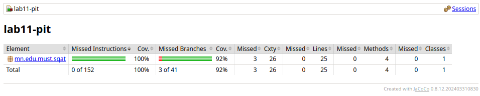

# Лаб 11 - B232270068 А.Баяржавхлан

## Туршилтын орчин

Java:
```
openjdk version "21.0.13.1" 2026-11-17
OpenJDK Runtime Environment (build 21.0.13.1+2-1-24.04.1-Ubuntu)
OpenJDK 64-Bit Server VM (build 21.0.13.1+2-1-24.04.1-Ubuntu, mixed mode, sharing)
```

Maven:
```
Apache Maven 3.8.7
Maven home: /usr/share/maven
Java version: 21.0.13.1, vendor: Ubuntu, runtime: /usr/lib/jvm/java-21-openjdk-amd64
Default locale: en_US, platform encoding: UTF-8
OS name: "linux", version: "6.8.0-151-generic", arch: "amd64", family: "unix"
```

OpenJDK 21 + Maven 3.8.7 орчинд ажиллуулахын тулд starter-ийн `pom.xml`-ийг зассан: `maven.compiler.release` 17 → 21, `maven-compiler-plugin` 3.13.0, `maven-resources-plugin` 3.3.1

`results/` доторх бүх гаралтыг ANSI escape sequence-гүй байлгахын тулд `ansi2txt`-ээр дамжуулж хадгалсан:
```bash
mvn clean verify 2>&1 | ansi2txt | tee results/mvn-verify-start.txt
cp target/site/jacoco/jacoco.csv results/jacoco-start.csv
mvn clean test-compile org.pitest:pitest-maven:mutationCoverage 2>&1 | ansi2txt | tee results/pit-start.txt
```


## Эхний хэмжилт

### JaCoCo

`results/mvn-verify-start.txt`: `Tests run: 6, Failures: 0, Errors: 0, Skipped: 0`. `results/jacoco-start.csv`:

| Хэмжүүр     | Covered | Missed | Нийт | Хамралт |
| ----------- | ------- | ------ | ---- | ------- |
| Line        | 25      | 0      | 25   | 100%    |
| Branch      | 38      | 3      | 41   | ≈ 92.7% |
| Instruction | 152     | 0      | 152  | 100%    |



Дутуу 3 салаа: 48-р мөрийн `gpa < 0`-ийн үнэн утга (сөрөг голчтой тест байхгүй), 52, 53-р мөрийн `&&`-ийн голч хангасан ч кредит дутуу тохиолдол.

### PIT

`results/pit-start.txt`:
```
>> Line Coverage (for mutated classes only): 25/25 (100%)
>> Generated 63 mutations Killed 17 (27%)
>> Mutations with no coverage 0. Test strength 27%
```

| Мутатор (PIT)                         | Generated | Killed | Survived |
| ------------------------------------- | --------- | ------ | -------- |
| `ConditionalsBoundaryMutator`         | 14        | 1      | 13       |
| `RemoveConditionalMutator_ORDER_IF`   | 14        | 4      | 10       |
| `RemoveConditionalMutator_ORDER_ELSE` | 14        | 5      | 9        |
| `RemoveConditionalMutator_EQUAL_IF`   | 3         | 2      | 1        |
| `RemoveConditionalMutator_EQUAL_ELSE` | 3         | 2      | 1        |
| `MathMutator`                         | 5         | 3      | 2        |
| `EmptyObjectReturnValsMutator`        | 5         | 0      | 5        |
| `PrimitiveReturnsMutator`             | 4         | 0      | 4        |
| `experimental.SwitchMutator`          | 1         | 0      | 1        |
| **Нийт**                              | **63**    | **17** | **46**   |


